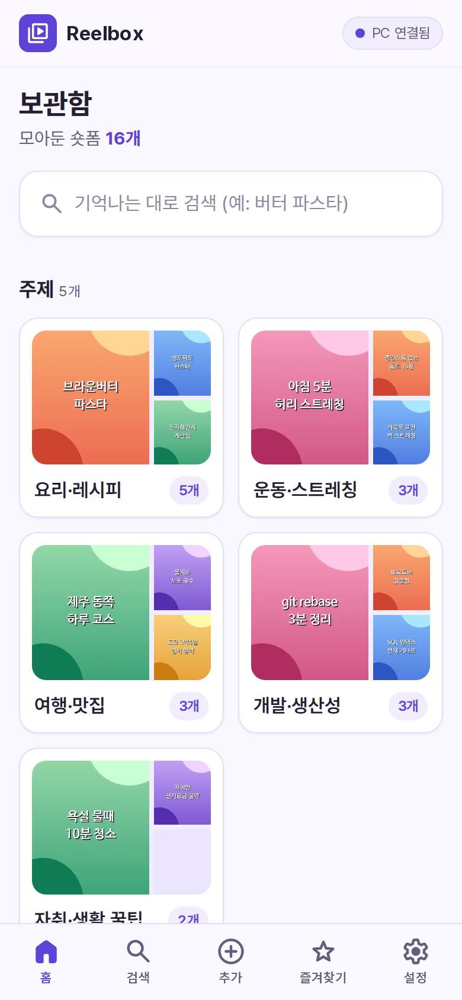
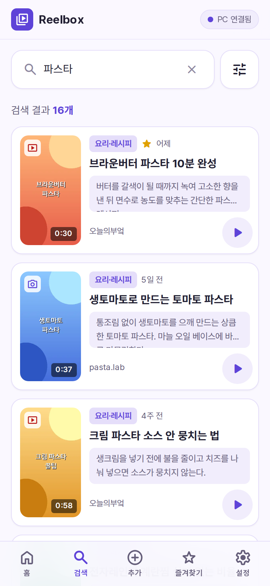
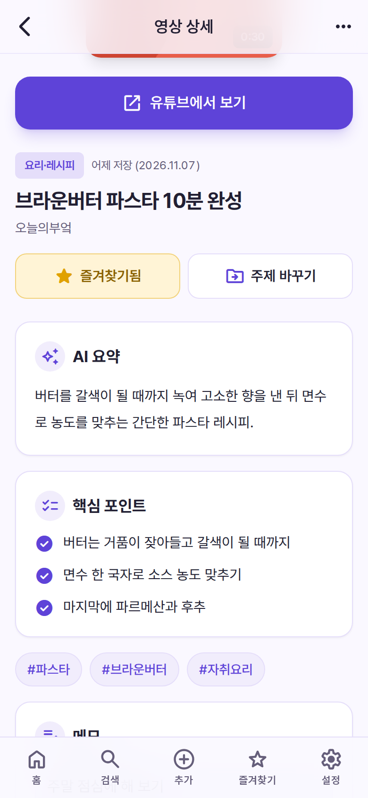
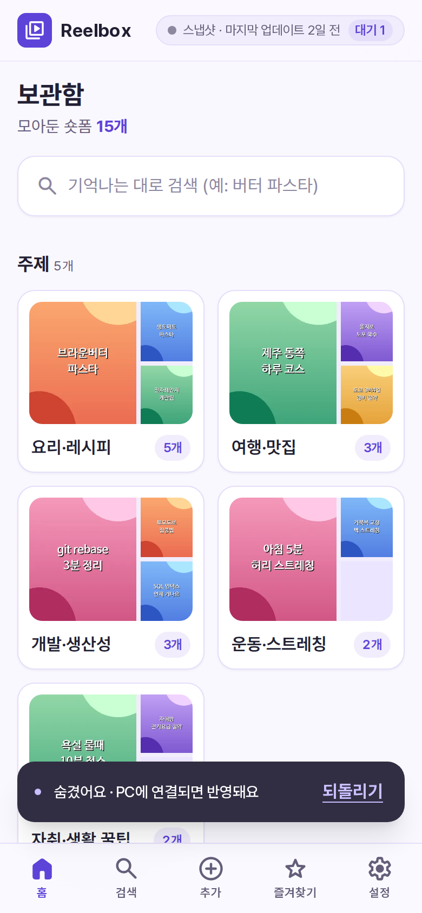
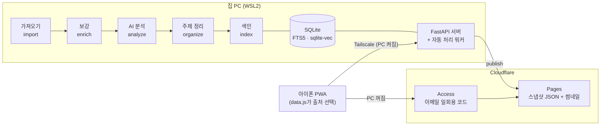

# Reelbox

저장만 해 두고 다시 찾지 못하는 **인스타그램 릴스·유튜브 쇼츠**를 한꺼번에 가져와서, AI가 요약하고 주제별로 묶어 주는 개인용 앱입니다. 휴대폰에서 주제별로 훑어보거나 "그 브라운버터 파스타"처럼 기억나는 대로 검색하고, 탭하면 원본 앱에서 바로 봅니다.

| 홈 · 주제별 보기 | 검색 | 영상 상세 | PC가 꺼져 있을 때 |
| :---: | :---: | :---: | :---: |
|  |  |  |  |

> 스크린샷은 저작권·개인정보 보호를 위해 **지어낸 데모 데이터와 직접 그린 썸네일**로 찍었습니다.

## 왜 만들었나

릴스와 쇼츠를 "나중에 봐야지" 하고 저장하다 보니 수백 개가 쌓였는데, 저장 목록에는 검색도 분류도 없어서 다시 찾을 수가 없었습니다. 저장한 것을 한 번에 꺼내서 내용으로 찾을 수 있게 만드는 것이 목표입니다.

## 주요 기능

- **한꺼번에 가져오기**: 인스타그램 "내 정보 다운로드" 파일, 유튜브 "저장된 Shorts" 목록
- **보강**: 메타데이터·자막을 받고, 자막이 없으면 음성을 받아쓰기 (영상 파일은 저장하지 않고 오디오만 잠깐 받았다 지움)
- **AI 분석**: 영상마다 한국어 요약, 핵심 포인트, 태그를 붙이고 비슷한 것끼리 주제로 묶기
- **검색**: 정확한 단어(키워드)와 비슷한 뜻(의미)을 함께 찾기, 영상마다 "비슷한 영상" 5개
- **휴대폰 앱(PWA)**: 홈 화면에 설치, 원본 앱으로 열기, 즐겨찾기·메모, 주제 이름 바꾸기·합치기, 숨기기·휴지통(30일)
- **공유로 추가**: 아이폰 공유 버튼(단축어)으로 보낸 링크를 PC가 자동으로 끝까지 처리
- **PC가 꺼져 있어도 보기**: 마지막 스냅샷을 Cloudflare Pages에서 보고, 그동안 한 숨기기·추가는 휴대폰에 모아 뒀다가 PC가 켜지면 전송

## 구조

무거운 일(자막·음성·AI)은 집 PC가 맡고, 휴대폰은 화면만 담당합니다. 집 밖에서는 Tailscale(내 기기끼리만 연결되는 사설망)로 PC에 접속하고, PC가 꺼져 있으면 Cloudflare Pages의 스냅샷을 봅니다.



각 단계는 따로 실행할 수 있는 CLI 명령이고, 모든 단계가 멱등(다시 돌려도 끝난 건 건너뜀)이라 중간에 멈춰도 이어서 처리됩니다.

## 기술 스택

| 역할 | 사용한 것 |
| --- | --- |
| 언어·CLI | Python 3.12, uv, Typer, Pydantic |
| 저장소 | SQLite + FTS5(trigram) + sqlite-vec |
| 메타·자막·오디오 | yt-dlp, ffmpeg |
| 음성 받아쓰기 | faster-whisper (로컬, CPU) |
| 요약·분류 | Claude API (Haiku 등급) |
| 임베딩 | BAAI/bge-m3 (로컬, sentence-transformers) |
| 웹 | FastAPI + 빌드 없는 정적 화면 (Alpine.js, Tailwind), PWA |
| 휴대폰 안 검색 | MiniSearch |
| 접속·배포 | Tailscale, Cloudflare Pages + Access, wrangler |
| 테스트 | pytest (외부 서비스는 전부 가짜로 대체, 네트워크 없이 333개), Playwright |

## 기술적으로 고민한 점

### 1. 한국어 두 글자 검색어

**문제** 한국어 부분 검색을 위해 FTS5의 trigram(세 글자 조각) 색인을 썼는데, trigram은 **세 글자보다 짧은 검색어를 찾지 못합니다.** 한국어에는 "김밥", "간식", "청소"처럼 두 글자 단어가 많습니다.

**해결**
- 검색어를 길이로 나눠, 세 글자 이상은 FTS5(BM25)로, **두 글자 이하는 `LIKE`로 따로 찾아** 세 번째 순위표로 만들고 아래 RRF로 합칩니다.
- PC가 꺼진 스냅샷 모드에서는 서버가 없어 휴대폰 안에서 MiniSearch로 찾는데, 기본 단어 나누기는 띄어쓰기 단위라 "파스타를"로 저장된 글을 "파스타"로 못 찾습니다. 그래서 **한글을 두 글자씩 겹쳐 자르는 토큰화**("파스타를" → 파스·스타·타를)를 직접 만들어, 조사가 붙어 있어도 검색어 조각이 모두 들어 있으면 찾게 했습니다.

`src/reelbox/search/query.py`, `src/reelbox/web/static/search_ko.js`

### 2. 키워드 검색 + 의미 검색 합치기 (RRF)

**문제** 키워드 검색은 정확한 단어가 있어야 하고, 의미 검색(bge-m3 임베딩)은 뜻은 잘 잡지만 고유명사·짧은 단어에 약합니다. 두 결과의 점수(BM25 점수와 코사인 거리)는 단위가 달라 그대로 더할 수 없습니다.

**해결** 점수 대신 **순위만** 쓰는 RRF(Reciprocal Rank Fusion)로 합칩니다. 각 순위표의 r등에 `1 / (60 + r)`점을 주고 더합니다. 단어를 정확히 찾는 사서와 뜻으로 찾는 사서의 추천 순위를 합산하는 방식입니다. 의미 검색 모델을 불러오는 동안(CPU에서 약 30초)은 키워드만으로 먼저 답하고 화면에 표시합니다. 필터(플랫폼·주제·기간·즐겨찾기)는 벡터 거리 계산 **전에** 걸어서, 필터 때문에 결과가 빠지지 않게 했습니다.

`src/reelbox/search/query.py`

### 3. 인스타그램 차단을 피하는 속도 제한과 단계별 쉬기

**문제** 인스타그램은 공식 API가 없어 내 로그인 쿠키로 정보를 받아야 하고, 너무 빠르게 요청하면 계정이 제한될 수 있습니다. 또 공유로 들어온 영상을 자동 처리하는 워커가 오류 직후 바로 다시 시도하면, 같은 영상의 재시도 횟수(3회)를 몇 분 만에 다 써 버립니다.

**해결**
- 요청 사이에 **5~10초 무작위 간격**(설정으로도 5초 밑으로 못 내림), **최근 24시간 처리 개수 한도**(기본 200개)를 요청 기록 표(`fetch_log`)로 세고, 차단 신호가 오면 그 자리에서 멈춥니다.
- 워커는 인스타·유튜브·AI 중 **멈춘 단계만 30분 쉬고**, 나머지 단계는 계속 돌립니다. 쉬는 이유와 다시 시도할 시각은 휴대폰 추가 화면에 보여줍니다.
- 그래도 막히면 접속 없이 내보내기 파일의 캡션만으로 분석하는 길(`enrich --captions-only`)을 남겨 뒀습니다.

`src/reelbox/enrich/runner.py`, `src/reelbox/worker.py`

### 4. PC가 꺼져 있어도 쓰는 구조

**문제** PC가 서버라서, 노트북을 덮으면 휴대폰 앱도 멈춥니다.

**해결**
- PC가 켜질 때·하루 한 번·처리가 끝날 때 결과를 **스냅샷(JSON + 썸네일)** 으로 묶어 Cloudflare Pages에 올립니다. 숨김·삭제 항목과 자막 원문은 넣지 않고, 내용이 바뀌지 않았으면 올리지 않습니다.
- 휴대폰 앱은 하나입니다. 화면은 `data.js` 한 곳에서만 데이터를 읽고, `data.js`가 **PC에 2초 동안 연결을 시도해 답이 없으면 스냅샷으로 전환**합니다. 화면 위에는 "PC 연결됨" / "스냅샷 · 마지막 업데이트 N일 전"이 뜹니다.
- 스냅샷에서 누른 숨기기·삭제·즐겨찾기·추가는 **IndexedDB 대기열**에 쌓고 화면에 먼저 반영합니다. 앱을 다시 열 때 PC가 연결되면 순서대로 보내고, 대기열 개수를 항상 표시합니다.
- Pages 주소는 인터넷에 공개되므로 Cloudflare Access(이메일 일회용 코드)로 잠그고, **배포 전에 정문과 배포별 주소가 모두 로그인 화면으로 넘어가는지 자동으로 확인**한 뒤에만 올립니다.

`src/reelbox/publish.py`, `src/reelbox/web/static/data.js`

## 실행 방법

필요한 것: Python 3.12 + [uv](https://docs.astral.sh/uv/), ffmpeg, Claude API 키. 휴대폰에서 쓰려면 Tailscale, PC가 꺼졌을 때 보려면 Cloudflare 계정과 Node.js.

```bash
uv sync
cp .env.example .env              # API 키, REELBOX_TOKEN, 쿠키 설정 등을 채운다
uv run reelbox init               # DB 만들기

# 가져오기
uv run reelbox import instagram <내보내기 zip 또는 폴더>
uv run reelbox sync youtube

# 처리 (처음엔 적은 개수로)
uv run reelbox enrich --limit 20
uv run reelbox analyze --limit 20
uv run reelbox organize           # 처음 주제 정리
uv run reelbox index

uv run reelbox search "버터 파스타" --keyword-only   # 터미널에서 확인
uv run reelbox serve              # 휴대폰 화면 + API + 자동 처리 워커 (127.0.0.1)
```

- 휴대폰 접속은 `tailscale serve`로 HTTPS 주소를 받아서 합니다 (외부 포트는 열지 않음).
- 이후에는 `uv run reelbox run`(공유 항목 처리 + publish), `uv run reelbox run --limit N`(아직 안 한 항목까지 N개)으로 이어서 처리합니다.
- 보기 전용 사이트 설정은 [docs/cloudflare-setup.md](docs/cloudflare-setup.md), 배포는 `uv run reelbox publish`.
- 테스트: `./scripts/check.sh` (ruff + pytest, 네트워크 없이 통과)

## 문서

- [docs/DESIGN.md](docs/DESIGN.md): 설계 문서. 데이터 모델, 처리 단계, 화면, 단계별 개발 계획(Phase 0~8)과 각 단계에서 내린 결정
- [docs/cloudflare-setup.md](docs/cloudflare-setup.md): Cloudflare Pages + Access 설정 안내

## 한계와 책임 있는 사용

- **개인 용도**로 만든 앱입니다. 여러 사용자, 회원가입은 없습니다.
- 영상 파일을 보관·재배포하지 않습니다. 분석용 오디오는 잠깐 받았다가 지우고, 영상은 원본 앱으로 연결만 합니다.
- 인스타그램 요청 간격·하루 한도를 지키고, 원본 저장 목록은 건드리지 않습니다.
- PC가 꺼져 있을 때는 의미 검색과 새 영상 처리가 멈추고, 스냅샷은 마지막으로 올린 시점의 내용입니다.
